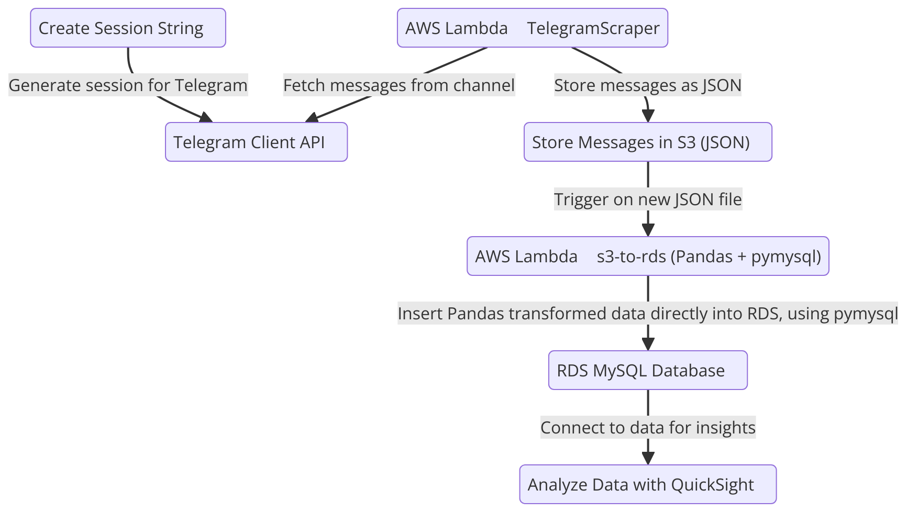

# Telegram Alerts → AWS Serverless ETL → MySQL

A serverless ETL pipeline that collects Israeli Home Front Command alert messages from their public Telegram channel (`PikudHaOref_all`), turns the free-text Hebrew messages into structured rows (event type, area, time, city), and loads them incrementally into Amazon RDS MySQL for analysis in QuickSight.



## How it works

1. **Extract: Telegram scraper Lambda** ([`Telegram_Scraper.py`](Telegram_Scraper.py))
   Connects to Telegram with Telethon, using a saved session string, reads the latest 80 messages from the channel, and writes them to S3 as `telegram_messages.json`.
2. **Trigger:** a new JSON file in S3 triggers the second Lambda.
3. **Transform: S3-to-RDS Lambda** ([`s3_to_rds.py`](s3_to_rds.py))
   Uses Pandas to parse each unstructured Hebrew message:
   - **event:** the alert type, the text before the `[` timestamp, cleaned to Hebrew characters
   - **area:** the region that follows `אזור`
   - **datetime:** extracted from the `[dd/mm/yyyy hh:mm]` block
   - **city:** a single message lists many cities, so the list is split and exploded into **one row per city**
4. **Load (incremental):** rows go into a staging table (`temp_telegram_data`, truncated on each run). Only rows newer than `MAX(datetime)` in the main table (`telegram_data`) are then inserted, so repeated runs don't create duplicates.
5. **Analyze:** QuickSight connects to the MySQL database for dashboards.

[`telegram_string_session_topresent.py`](telegram_string_session_topresent.py) is a one-time helper that generates the Telegram session string the Lambda needs, so no interactive login happens inside Lambda.

## Tech stack

AWS Lambda · Amazon S3 (event trigger) · Amazon RDS MySQL · Amazon QuickSight · Python · Pandas · Telethon · PyMySQL

## Setup

### AWS resources
- An **S3 bucket** for the raw JSON, with an event notification that invokes the S3-to-RDS Lambda.
- An **RDS MySQL** database with two tables, `telegram_data` and `temp_telegram_data`, each with the columns `message, event, area, datetime, city`.
- Two **Lambda functions** (Python 3.12):
  - The scraper needs `telethon`.
  - The S3-to-RDS function uses the AWS-managed `AWSSDKPandas-Python312` layer (Pandas + boto3) and a custom layer with `pymysql`.
  - The S3-to-RDS Lambda must be able to reach RDS, through VPC access and security-group rules.

### Configuration
Credentials are never stored in the code. They are set as Lambda environment variables:

| Lambda | Variable | Purpose |
|--------|----------|---------|
| Scraper | `TELEGRAM_APP_API_ID`, `TELEGRAM_APP_API_HASH` | Telegram API app credentials (from my.telegram.org) |
| Scraper | `TELEGRAM_STRING_SESSION` | Session string from the helper script |
| Scraper | `S3_BUCKET_NAME` | Target bucket for the raw JSON |
| S3-to-RDS | `DB_PASSWORD` | MySQL password |

### Deploy
```bash
pip install telethon -t package/ && cp Telegram_Scraper.py package/
(cd package && zip -r ../telegram_scraper.zip .)
aws lambda update-function-code --function-name telegram-scraper-lambda --zip-file fileb://telegram_scraper.zip

zip s3_to_rds.zip s3_to_rds.py
aws lambda update-function-code --function-name s3-to-rds-lambda --zip-file fileb://s3_to_rds.zip
```

## Example output

One alert message becomes one row per city:

| event | area | datetime | city |
|-------|------|----------|------|
| ירי רקטות וטילים | גליל עליון | 2024-09-24 10:30 | City A |
| ירי רקטות וטילים | גליל עליון | 2024-09-24 10:30 | City B |

*(Illustrative values.)*

## Possible improvements
- Move the database host, name and bucket into environment variables, as already done for the credentials.
- Track the last processed Telegram message ID instead of re-reading the latest 80 messages.
- Schedule the scraper with EventBridge for continuous collection.
